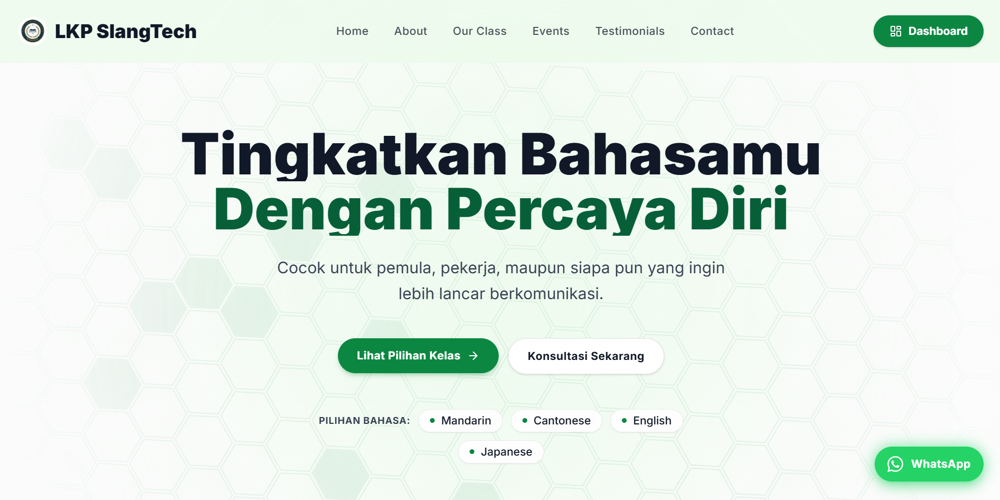

# LKP SlangTech - Client Portal (Web Siswa)

Portal publik dan siswa untuk platform kursus dan pelatihan teknologi **LKP SlangTech**. Aplikasi ini menangani eksplorasi katalog kelas/event, pendaftaran program, upload bukti pembayaran, profil siswa, serta notifikasi terintegrasi.

---

## Fitur Utama

- **Katalog Kelas & Event**:
  - Daftar kelas (Private & Group) dengan deskripsi kurikulum, benefit, dan harga diskon.
  - Daftar event, workshop, dan webinar dengan detail jadwal dan profil instruktur/trainer.
- **Autentikasi & Profil Pengguna**:
  - Registrasi, Login, dan Reset Password dengan **Firebase Authentication**.
  - Setup profil lengkap (nama lengkap, nomor WhatsApp, domisili/wilayah) via Firestore REST.
- **Alur Pendaftaran & Pembayaran**:
  - Formulir pendaftaran multi-step interaktif.
  - Upload bukti transfer pembayaran dengan validasi ukuran berkas (< 1.5 MB).
  - Integrasi penyimpanan bukti bayar langsung ke **Cloudflare R2 Object Storage**.
- **Notifikasi Otomatis**:
  - **Notifikasi WhatsApp Admin**: Gateway Baselab otomatis mengirim notifikasi instan ke WhatsApp admin setiap ada pendaftaran baru yang perlu diverifikasi.
  - **Email Tanda Terima**: Siswa menerima email otomatis berisi rincian pendaftaran dan status menunggu verifikasi via **Hostinger SMTP** (`nodemailer`).

---

## Tech Stack

- **Framework**: [Next.js](https://nextjs.org/) 16 (App Router, Turbopack)
- **UI Library**: [React](https://react.dev/) 19 & [Tailwind CSS](https://tailwindcss.com/)
- **Icons & Motion**: Lucide React & Framer Motion
- **Smooth Scrolling**: Lenis
- **Database & Auth**: Google Firebase (Authentication & Firestore REST API)
- **Storage**: Cloudflare R2 (S3 API Client)
- **Email Service**: Nodemailer (Hostinger SMTP)
- **WhatsApp Gateway**: Baselab WA Gateway API

---

## Arsitektur Aplikasi End-to-End

Berikut adalah representasi arsitektur sistem dari sisi aplikasi **Client** mulai dari antarmuka pengguna, API gateway internal (Route Handlers), logika bisnis domain, hingga integrasi database dan API eksternal:

```mermaid
flowchart TD
    subgraph ClientLayer["1. Client Web App (Frontend / Presentation Layer)"]
        UI_Home["Landing & Beranda (/home)"]
        UI_Classes["Katalog & Detail Kelas (/classes)"]
        UI_Events["Katalog & Detail Event (/events)"]
        UI_Enroll["Form Pendaftaran & Bayar (/classes/slug/register, /events/slug/register)"]
        UI_Auth["Autentikasi & Profil (/login, /register, /profile/setup)"]
    end

    subgraph APILayer["2. Internal API Gateway / Route Handlers (Next.js Serverless)"]
        API_Upload["/api/upload-payment (Upload & Kompresi Bukti Bayar / Absensi)"]
        API_WA["/api/whatsapp/notify-admin (Notifikasi WA Admin Baru Daftar)"]
        API_Email["/api/*-registration-email (Kirim Tanda Terima Email via SMTP)"]
        API_Regions["/api/regions (Proxy Data Wilayah Indonesia)"]
    end

    subgraph ServiceLayer["3. Domain Services (Business Logic)"]
        SRV_Auth["User & Auth Service (firebase-auth.ts)"]
        SRV_Content["Content Service (classes.ts, events.ts, information.ts)"]
        SRV_Enroll["Enrollment & Payment Service (enrollments.ts)"]
        SRV_Region["Region Service (indonesia-regions.ts)"]
    end

    subgraph ExternalServices["4. External APIs & Database Store"]
        EXT_FirebaseAuth["Google Firebase Auth (Identity Toolkit API)"]
        EXT_Firestore["Google Cloud Firestore (REST API Database)"]
        EXT_R2["Cloudflare R2 Object Storage (AWS S3-compatible API)"]
        EXT_TinyPNG["TinyPNG API (Image Compression)"]
        EXT_Baselab["Baselab WhatsApp Gateway API"]
        EXT_SMTP["Hostinger SMTP Mail Server"]
        EXT_RegionsAPI["API Daerah Indonesia (api-daerah-indonesia.vercel.app)"]
    end

    %% Interaksi Client ke Gateway & Services
    UI_Auth --> SRV_Auth
    UI_Classes --> SRV_Content
    UI_Events --> SRV_Content
    UI_Enroll --> SRV_Enroll

    UI_Enroll --> API_Upload
    UI_Enroll --> API_WA
    UI_Enroll --> API_Email
    UI_Auth --> API_Regions

    %% Interaksi Gateway ke External Services
    API_Upload -- "1. Verifikasi ID Token" --> EXT_FirebaseAuth
    API_Upload -- "2. Kompresi Foto Bukti" --> EXT_TinyPNG
    API_Upload -- "3. Simpan Objek via S3 SigV4" --> EXT_R2

    API_WA -- "1. Verifikasi ID Token" --> EXT_FirebaseAuth
    API_WA -- "2. Kirim Notif WhatsApp Admin" --> EXT_Baselab

    API_Email -- "1. Verifikasi ID Token" --> EXT_FirebaseAuth
    API_Email -- "2. Kirim Email Transaksional Siswa & Admin" --> EXT_SMTP

    API_Regions -- "Proxy & Cache Data Wilayah" --> EXT_RegionsAPI

    %% Interaksi Domain Services ke Firestore & Auth
    SRV_Auth -- "Login / Register / Refresh Token" --> EXT_FirebaseAuth
    SRV_Auth -- "Simpan & Baca Profil Siswa" --> EXT_Firestore
    SRV_Content -- "Ambil Data Kelas, Event & Pengumuman" --> EXT_Firestore
    SRV_Enroll -- "Query & Simpan Transaksi Pendaftaran" --> EXT_Firestore
```



---

### Rincian Komponen Arsitektur

#### 1. Web App (Client Presentation Layer)
- Antarmuka web siswa dan publik berbasis Next.js 16 App Router dengan Server-Side Rendering (SSR) dan Client Components.
- Modul halaman:
  - `/` dan `/home`: Beranda publik, informasi keunggulan program, ulasan alumni, dan navigasi pendaftaran.
  - `/classes` dan `/classes/[slug]`: Katalog kelas privat dan grup, silabus, fasilitas, serta detail biaya.
  - `/events` dan `/events/[slug]`: Katalog workshop, webinar, jadwal sesi, profil pemateri, dan presensi per sesi.
  - `/classes/[slug]/register` dan `/events/[slug]/register`: Alur pendaftaran multi-step, pemilihan metode transfer bank, dan upload bukti bayar.
  - `/login`, `/register`, dan `/profile/setup`: Autentikasi siswa dan pengisian data domisili wilayah.
  - `/informasi`: Publikasi pengumuman dan berita resmi LKP SlangTech.

#### 2. Content Service
Content Service mengelola pengambilan data publik langsung dari Firestore REST API tanpa server backend terpisah:
- `classes.ts`: Mengambil data kelas aktif, filter kategori (privat/grup), pencarian teks, dan detail kelas berdasarkan slug atau ID dari koleksi `classes`.
- `events.ts`: Mengambil data event, jadwal sesi, status kuota, dan profil instruktur dari koleksi `events`.
- `information.ts`: Mengambil artikel dan pengumuman dari koleksi `information`.
- Mekanisme: Request langsung ke Firestore REST API menggunakan fungsi `fetch` bawaan Next.js dengan kontrol cache.

#### 3. User & Authorizer Service
- Layanan autentikasi (`firebase-auth.ts`):
  - Mengelola sesi login, pendaftaran akun baru, dan refresh token melalui Firebase Client SDK.
  - Menyimpan data profil siswa (nama, WhatsApp, domisili provinsi hingga kelurahan) pada dokumen Firestore `users/{uid}`.
- Authorizer di Route Handlers (`verifyFirebaseUser`):
  - Memvalidasi token sesi siswa (`idToken`) ke endpoint Google Identity Toolkit sebelum memproses upload bukti bayar atau pengiriman email.
  - Memastikan request mutasi data berasal dari pengguna yang terautentikasi.

#### 4. Enrollment & Payment Service (`enrollments.ts`)
Mengatur siklus hidup pendaftaran siswa:
1. Validasi sesi login dan kelengkapan data pendaftaran.
2. Pengunggahan berkas bukti transfer ke `/api/upload-payment`.
3. Pembuatan dokumen pendaftaran baru di koleksi Firestore `enrollments` dengan status `waiting_payment_confirmation`.
4. Pengiriman notifikasi pendaftaran masuk ke nomor WhatsApp admin via `/api/whatsapp/notify-admin`.
5. Pengiriman email tanda terima ke siswa dan notifikasi pendaftaran ke admin via `/api/*-registration-email`.
6. Pengelolaan pengajuan jadwal ulang (*reschedule*) dan presensi sesi event (*event attendance*).

---

### Integrasi API Eksternal

| Layanan | Endpoint / Protokol | Digunakan Pada | Fungsi |
| :--- | :--- | :--- | :--- |
| Google Firebase Identity Toolkit | `https://identitytoolkit.googleapis.com/v1/accounts:lookup` | Route Handlers (`upload-payment`, `whatsapp`, email) | Verifikasi `idToken` sesi siswa sebelum request mutasi data diproses serverless Next.js. |
| Google Cloud Firestore REST API | `https://firestore.googleapis.com/v1/...` | `features/classes`, `features/events`, `features/enrollments`, `features/auth` | Operasi baca dan simpan dokumen koleksi `classes`, `events`, `enrollments`, `users`, `information`, dan `settings`. |
| Cloudflare R2 Storage | `https://{ACCOUNT_ID}.r2.cloudflarestorage.com/{BUCKET_NAME}` | `/api/upload-payment` | Penyimpanan file bukti transfer (`payment-proofs/`) dan dokumentasi presensi (`event-attendances/`) via protokol AWS S3 SigV4 PUT. |
| TinyPNG API | `https://api.tinify.com/shrink` | `/api/upload-payment` | Kompresi gambar bukti transfer sebelum dikirim ke R2 agar berkas di bawah batas 1.5 MB. Mendukung rotasi API key. |
| Baselab WhatsApp Gateway | `https://api-wa.baselab.web.id/api/send-message` | `/api/whatsapp/notify-admin` | Pengiriman notifikasi WhatsApp ke admin saat formulir pendaftaran baru masuk. |
| Hostinger SMTP Mail Server | `smtp.hostinger.com` (Port 465 SSL) | `/api/class-registration-email`, `/api/event-registration-email` | Pengiriman email tanda terima pendaftaran siswa dan notifikasi pendaftaran ke admin melalui Nodemailer. |
| API Daerah Indonesia | `https://api-daerah-indonesia.vercel.app/api` | `/api/regions` | Penyedia data wilayah (provinsi, kabupaten/kota, kecamatan, kelurahan) untuk form setup profil siswa dengan cache 7 hari. |

---

## Struktur Direktori

```text
client/
├── app/                          # Next.js App Router (Halaman & Endpoint API)
│   ├── api/                      # Route Handlers (Email, R2 Upload, WhatsApp, Regions)
│   │   ├── class-registration-email/ # Dispatch email pendaftaran kelas via SMTP
│   │   ├── event-registration-email/ # Dispatch email pendaftaran event via SMTP
│   │   ├── regions/                  # Proxy & caching data wilayah Indonesia
│   │   ├── upload-payment/           # Upload bukti bayar & absensi ke Cloudflare R2
│   │   └── whatsapp/                 # Gateway notifikasi WhatsApp (Admin & Siswa)
│   │       ├── message/              # Pengiriman pesan WhatsApp umum
│   │       └── notify-admin/         # Notifikasi instan pendaftaran masuk ke admin
│   ├── classes/                  # Halaman daftar katalog dan detail kelas
│   ├── events/                   # Halaman daftar katalog dan detail event
│   ├── home/                     # Halaman landing & beranda publik
│   ├── informasi/                # Halaman pengumuman & berita resmi
│   ├── login/ & register/        # Halaman autentikasi siswa
│   └── profile/setup/            # Halaman pengisian profil & data domisili siswa
├── components/                   # Komponen UI global (Navbar, Footer, UI primitives)
├── features/                     # Arsitektur modular berbasis domain (Domain-Driven)
│   ├── auth/                     # Layanan autentikasi Firebase & form profil
│   ├── classes/                  # Katalog kelas, detail, dan form registrasi kelas
│   ├── enrollments/              # Siklus hidup pendaftaran, upload bukti, dan jadwal
│   ├── events/                   # Katalog event, pendaftaran event, dan absensi
│   ├── home/                     # Komponen section beranda siswa
│   ├── information/              # Komponen dan service informasi/pengumuman
│   └── marketing/                # Komponen landing page (Bento grid, FAQ, Testimoni)
├── hooks/                        # Custom React hooks (use-mobile, use-toast)
├── lib/                          # Utility & helper terpusat
│   ├── whatsapp.ts               # Sinkronisasi WhatsApp config via Firestore
│   ├── site.ts                   # Metadata dan SEO website
│   └── utils.ts                  # Helper fungsi styling (clsx, tailwind-merge)
└── public/                       # Aset gambar, logo, ikon, dan banner
```

---

## Panduan Menjalankan

### 1. Instalasi Dependensi
```bash
npm install
```

### 2. Mode Pengembangan (Development)
```bash
npm run dev
```
Aplikasi berjalan di [http://localhost:3000](http://localhost:3000).

### 3. Kompilasi Produksi (Production Build)
```bash
npm run build
```
```bash
npm start
```
