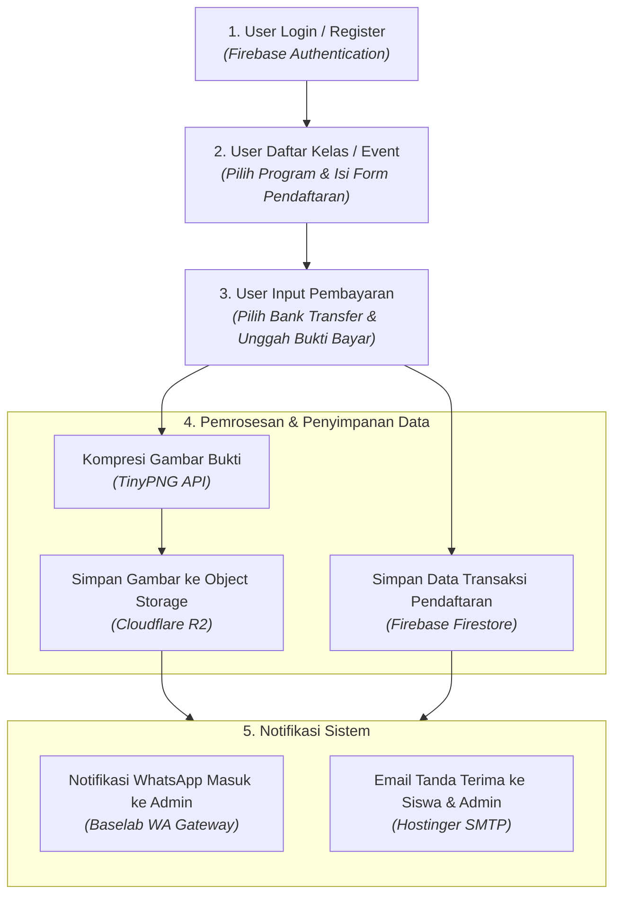
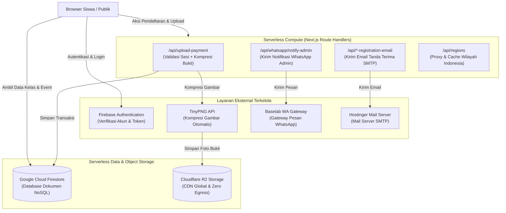

# LKP SlangTech - Client Portal (Web Siswa)

Portal publik dan siswa untuk platform kursus dan pelatihan teknologi **LKP SlangTech**. Aplikasi ini menangani eksplorasi katalog kelas/event, pendaftaran program, upload bukti pembayaran, profil siswa, serta notifikasi terintegrasi.

---

## Fitur Utama

- **Katalog Kelas & Event**:
  - Daftar kelas (Private & Group) dengan deskripsi kurikulum, benefit, dan harga diskon.
  - Daftar event, workshop, dan webinar dengan detail jadwal dan profil instruktur/trainer.
- **Autentikasi & Profil Pengguna**:
  - Registrasi, Login, dan Reset Password dengan **Firebase Authentication**.
  - Setup profil lengkap (nama lengkap, nomor WhatsApp, domisili/wilayah) via Firestore REST.
- **Alur Pendaftaran & Pembayaran**:
  - Formulir pendaftaran multi-step interaktif.
  - Upload bukti transfer pembayaran dengan validasi ukuran berkas (< 1.5 MB).
  - Integrasi penyimpanan bukti bayar langsung ke **Cloudflare R2 Object Storage**.
- **Notifikasi Otomatis**:
  - **Notifikasi WhatsApp Admin**: Gateway Baselab otomatis mengirim notifikasi instan ke WhatsApp admin setiap ada pendaftaran baru yang perlu diverifikasi.
  - **Email Tanda Terima**: Siswa menerima email otomatis berisi rincian pendaftaran dan status menunggu verifikasi via **Hostinger SMTP** (`nodemailer`).

---

## Tech Stack

- **Framework**: [Next.js](https://nextjs.org/) 16 (App Router, Turbopack)
- **UI Library**: [React](https://react.dev/) 19 & [Tailwind CSS](https://tailwindcss.com/)
- **Icons & Motion**: Lucide React & Framer Motion
- **Smooth Scrolling**: Lenis
- **Database & Auth**: Google Firebase (Authentication & Firestore REST API)
- **Storage**: Cloudflare R2 (S3 API Client)
- **Email Service**: Nodemailer (Hostinger SMTP)
- **WhatsApp Gateway**: Baselab WA Gateway API

---

## Arsitektur Aplikasi End-to-End

Berikut alur transaksi dan arsitektur aplikasi dari sisi Client, mulai dari autentikasi pengguna hingga pemrosesan berkas dan notifikasi sistem:



---

### Rincian Alur dan Komponen Aplikasi

Penjelasan bagaimana setiap bagian aplikasi bekerja secara berurutan saat siswa mendaftar program:

#### 1. Tampilan Web Siswa (`client/app`)
Bagian depan website yang dilihat dan digunakan langsung oleh siswa melalui browser:
- Halaman Beranda (`/home`): Menampilkan perkenalan program, materi kursus, dan testimoni alumni.
- Katalog Kelas & Event (`/classes`, `/events`): Halaman untuk melihat detail silabus, profil pengajar, jadwal pertemuan, dan biaya.
- Formulir Pendaftaran (`/register`, `/profile/setup`): Tempat siswa mendaftar akun baru, melengkapi profil domisili, dan mengisi formulir program.
- Halaman Informasi (`/informasi`): Berisi update pengumuman dan berita resmi dari LKP SlangTech.

#### 2. Layanan Konten Program (`features/classes` & `features/events`)
Bagian yang bertugas mengambil dan menampilkan data kursus dari database:
- Mengambil daftar kelas dan event aktif secara langsung dari Google Cloud Firestore.
- Menyaring data berdasarkan kategori (kursus privat atau grup) serta pencarian nama kelas.
- Menyajikan detail informasi sesi belajar secara cepat tanpa perlu menunggu respon server terpisah.

#### 3. Keamanan Akun dan Sesi Siswa (`features/auth`)
Bagian yang menjaga keamanan akses akun siswa:
- Menangani pendaftaran akun baru, login, dan reset kata sandi menggunakan Firebase Authentication.
- Memeriksa keabsahan tiket masuk (*token login*) siswa setiap kali mengirim formulir atau mengunggah bukti bayar, agar data tidak bisa dimanipulasi oleh pihak luar.
- Menyimpan profil siswa seperti nama lengkap, nomor WhatsApp, serta domisili tempat tinggal.

#### 4. Layanan Pendaftaran dan Pembayaran (`features/enrollments`)
Bagian inti yang memproses transaksi saat siswa mendaftar:
1. Menerima formulir pendaftaran dan berkas bukti transfer bank yang diunggah siswa.
2. Mengompres ukuran foto bukti bayar secara otomatis lewat TinyPNG agar ukuran berkas tetap ringan dan hemat kuota.
3. Menyimpan foto bukti bayar ke Cloudflare R2 dan mencatat data transaksi ke database Firestore dengan status "Menunggu Konfirmasi".
4. Mengirim notifikasi pesan WhatsApp ke admin SlangTech agar pembayaran segera diverifikasi.
5. Mengirim email bukti pendaftaran ke siswa sebagai tanda terima resmi.
6. Menyediakan menu bagi siswa untuk melihat jadwal kelas dan mengajukan perubahan jadwal (*reschedule*) bila berhalangan hadir.

---

### Pola Arsitektur Serverless

Aplikasi client ini dibangun di atas fondasi arsitektur **Serverless** (tanpa perlu mengelola server fisik atau VPS manual):



1. **Komputasi On-Demand (Stateless Handlers)**:
   - Logika backend pada rute `/app/api/*` (seperti upload bukti bayar, pengiriman email, dan notifikasi WhatsApp) berjalan sebagai fungsi serverless.
   - Fungsi komputasi hanya menyala saat ada panggilan request masuk dari siswa, lalu mati kembali setelah proses selesai (*scale-to-zero*).
2. **Penyimpanan Berkas & Database Terkelola Penuh**:
   - **Google Cloud Firestore**: Basis data NoSQL yang mengelola kapasitas dan replikasi data secara otomatis tanpa maintenance server database.
   - **Cloudflare R2**: Penyimpanan berkas terdistribusi global berbasis CDN tanpa biaya transfer keluar (*zero egress fee*).
3. **Keuntungan bagi Platform**:
   - **Bebas Perawatan Server**: Tidak memerlukan instalasi Nginx terpisah, konfigurasi Linux daemon, atau pembaruan keamanan OS berkala.
   - **Tahan Lonjakan Trafik**: Mampu menangani lonjakan pendaftaran kelas secara otomatis tanpa risiko server tumbang (*crash*).
   - **Efisiensi Biaya**: Biaya operasional hanya dihitung berdasarkan pemakaian komputasi dan transaksi yang benar-benar aktif (*pay-per-use*).

---

### Integrasi API Eksternal

| Layanan | Endpoint / Protokol | Digunakan Pada | Fungsi |
| :--- | :--- | :--- | :--- |
| Google Firebase Identity Toolkit | `identitytoolkit.googleapis.com`<br/>`/v1/accounts:lookup` | Route Handlers<br/>(`upload-payment`, `whatsapp`, email) | Verifikasi `idToken` sesi siswa sebelum request mutasi data diproses serverless Next.js. |
| Google Cloud Firestore REST API | `firestore.googleapis.com`<br/>`/v1/projects/{PROJECT_ID}/...` | `features/classes`<br/>`features/events`<br/>`features/enrollments`<br/>`features/auth` | Operasi baca dan simpan dokumen koleksi `classes`, `events`, `enrollments`, `users`, `information`, dan `settings`. |
| Cloudflare R2 Storage | `{ACCOUNT_ID}.r2.cloudflarestorage.com`<br/>`/{BUCKET_NAME}/*` | `/api/upload-payment` | Penyimpanan file bukti transfer (`payment-proofs/`) dan dokumentasi presensi (`event-attendances/`) via protokol AWS S3 SigV4 PUT. |
| TinyPNG API | `api.tinify.com`<br/>`/shrink` | `/api/upload-payment` | Kompresi gambar bukti transfer sebelum dikirim ke R2 agar berkas di bawah batas 1.5 MB. Mendukung rotasi API key. |
| Baselab WhatsApp Gateway | `api-wa.baselab.web.id`<br/>`/api/send-message` | `/api/whatsapp/notify-admin` | Pengiriman notifikasi WhatsApp ke admin saat formulir pendaftaran baru masuk. |
| Hostinger SMTP Mail Server | `smtp.hostinger.com`<br/>`Port 465 (SSL) / 587 (TLS)` | `/api/class-registration-email`<br/>`/api/event-registration-email` | Pengiriman email tanda terima pendaftaran siswa dan notifikasi pendaftaran ke admin melalui Nodemailer. |
| API Daerah Indonesia | `api-daerah-indonesia.vercel.app`<br/>`/api/...` | `/api/regions` | Penyedia data wilayah (provinsi, kabupaten/kota, kecamatan, kelurahan) untuk form setup profil siswa dengan cache 7 hari. |

---

## Struktur Direktori

```text
client/
├── app/                          # Next.js App Router (Halaman & Endpoint API)
│   ├── api/                      # Route Handlers (Email, R2 Upload, WhatsApp, Regions)
│   │   ├── class-registration-email/ # Dispatch email pendaftaran kelas via SMTP
│   │   ├── event-registration-email/ # Dispatch email pendaftaran event via SMTP
│   │   ├── regions/                  # Proxy & caching data wilayah Indonesia
│   │   ├── upload-payment/           # Upload bukti bayar & absensi ke Cloudflare R2
│   │   └── whatsapp/                 # Gateway notifikasi WhatsApp (Admin & Siswa)
│   │       ├── message/              # Pengiriman pesan WhatsApp umum
│   │       └── notify-admin/         # Notifikasi instan pendaftaran masuk ke admin
│   ├── classes/                  # Halaman daftar katalog dan detail kelas
│   ├── events/                   # Halaman daftar katalog dan detail event
│   ├── home/                     # Halaman landing & beranda publik
│   ├── informasi/                # Halaman pengumuman & berita resmi
│   ├── login/ & register/        # Halaman autentikasi siswa
│   └── profile/setup/            # Halaman pengisian profil & data domisili siswa
├── components/                   # Komponen UI global (Navbar, Footer, UI primitives)
├── features/                     # Arsitektur modular berbasis domain (Domain-Driven)
│   ├── auth/                     # Layanan autentikasi Firebase & form profil
│   ├── classes/                  # Katalog kelas, detail, dan form registrasi kelas
│   ├── enrollments/              # Siklus hidup pendaftaran, upload bukti, dan jadwal
│   ├── events/                   # Katalog event, pendaftaran event, dan absensi
│   ├── home/                     # Komponen section beranda siswa
│   ├── information/              # Komponen dan service informasi/pengumuman
│   └── marketing/                # Komponen landing page (Bento grid, FAQ, Testimoni)
├── hooks/                        # Custom React hooks (use-mobile, use-toast)
├── lib/                          # Utility & helper terpusat
│   ├── whatsapp.ts               # Sinkronisasi WhatsApp config via Firestore
│   ├── site.ts                   # Metadata dan SEO website
│   └── utils.ts                  # Helper fungsi styling (clsx, tailwind-merge)
└── public/                       # Aset gambar, logo, ikon, dan banner
```

---

## Panduan Menjalankan

### 1. Instalasi Dependensi
```bash
npm install
```

### 2. Mode Pengembangan (Development)
```bash
npm run dev
```
Aplikasi berjalan di [http://localhost:3000](http://localhost:3000).

### 3. Kompilasi Produksi (Production Build)
```bash
npm run build
```
```bash
npm start
```
