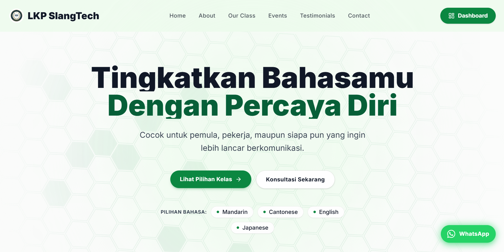

# LKP SlangTech - Client Portal (Web Siswa)

Portal publik dan siswa untuk platform kursus dan pelatihan teknologi **LKP SlangTech**. Aplikasi ini menangani eksplorasi katalog kelas/event, pendaftaran program, upload bukti pembayaran, profil siswa, serta notifikasi terintegrasi.

---

## 🚀 Fitur Utama

- **Katalog Kelas & Event**:
  - Daftar kelas (Private & Group) dengan deskripsi kurikulum, benefit, dan harga diskon.
  - Daftar event, workshop, dan webinar dengan detail jadwal dan profil instruktur/trainer.
- **Autentikasi & Profil Pengguna**:
  - Registrasi, Login, dan Reset Password dengan **Firebase Authentication**.
  - Setup profil lengkap (nama lengkap, nomor WhatsApp, domisili/wilayah) via Firestore REST.
- **Alur Pendaftaran & Pembayaran**:
  - Formulir pendaftaran multi-step interaktif.
  - Upload bukti transfer pembayaran dengan validasi ukuran berkas (< 1.5 MB).
  - Integrasi penyimpanan bukti bayar langsung ke **Cloudflare R2 Object Storage**.
- **Notifikasi Otomatis**:
  - **Notifikasi WhatsApp Admin**: Gateway Baselab otomatis mengirim notifikasi instan ke WhatsApp admin setiap ada pendaftaran baru yang perlu diverifikasi.
  - **Email Tanda Terima**: Siswa menerima email otomatis berisi rincian pendaftaran dan status menunggu verifikasi via **Hostinger SMTP** (`nodemailer`).

---

## 🛠️ Tech Stack

- **Framework**: [Next.js](https://nextjs.org/) 16 (App Router, Turbopack)
- **UI Library**: [React](https://react.dev/) 19 & [Tailwind CSS](https://tailwindcss.com/)
- **Icons & Motion**: Lucide React & Framer Motion
- **Smooth Scrolling**: Lenis
- **Database & Auth**: Google Firebase (Authentication & Firestore REST API)
- **Storage**: Cloudflare R2 (S3 API Client)
- **Email Service**: Nodemailer (Hostinger SMTP)
- **WhatsApp Gateway**: Baselab WA Gateway API

---

## 📁 Struktur Direktori

```text
client/
├── app/                          # Next.js App Router (Halaman & Endpoint API)
│   ├── api/                      # Route Handlers (Email, R2 Upload, WhatsApp)
│   │   ├── class-registration-email/
│   │   ├── event-registration-email/
│   │   ├── regions/              # API Wilayah Indonesia
│   │   ├── upload-payment/       # Upload bukti bayar ke Cloudflare R2
│   │   ├── whatsapp/             # Gateway notifikasi admin
│   │   └── zawa/                 # Layanan pesan WhatsApp siswa
│   ├── classes/                  # Halaman daftar dan detail kelas
│   ├── events/                   # Halaman daftar dan detail event
│   ├── home/                     # Halaman landing/beranda
│   ├── login/ & register/        # Halaman autentikasi
│   └── profile/                  # Halaman profil siswa
├── components/                   # Komponen UI global (Navbar, Footer, UI primitives)
├── features/                     # Arsitektur berbasis fitur (Domain-driven)
│   ├── auth/                     # Layanan autentikasi Firebase
│   ├── classes/                  # Komponen dan data katalog kelas
│   ├── enrollments/              # Layanan pendaftaran dan bukti pembayaran
│   └── events/                   # Komponen dan data katalog event
├── lib/                          # Utility & helper terpusat
│   ├── whatsapp.ts               # Sinkronisasi WhatsApp config via Firestore
│   ├── site.ts                   # Metadata website
│   └── utils.ts                  # Helper fungsi styling (clsx, tailwind-merge)
└── public/                       # Aset gambar, logo, dan favicon
```

---

## 💻 Panduan Menjalankan

### 1. Instalasi Dependensi
```bash
npm install
```

### 2. Mode Pengembangan (Development)
```bash
npm run dev
```
Aplikasi berjalan di [http://localhost:3000](http://localhost:3000).

### 3. Kompilasi Produksi (Production Build)
```bash
npm run build
npm start
```
